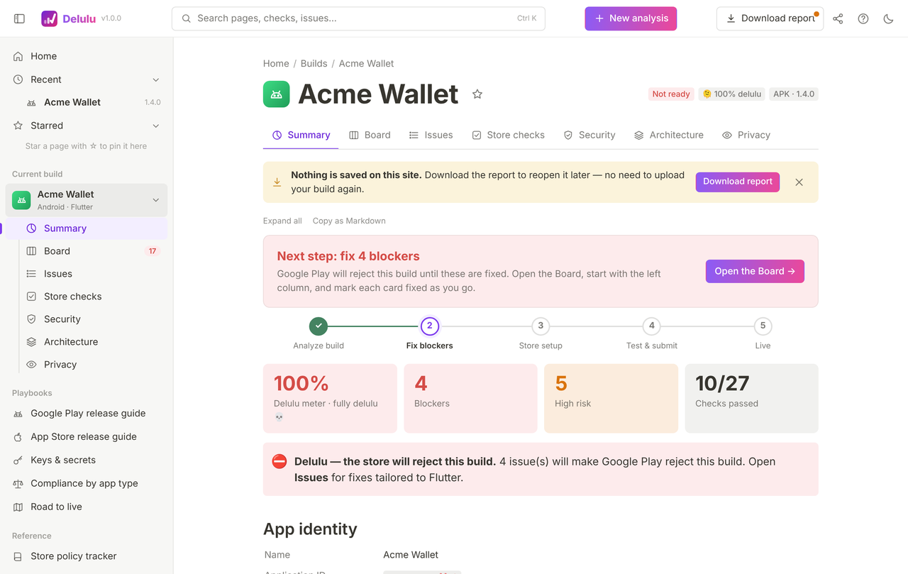
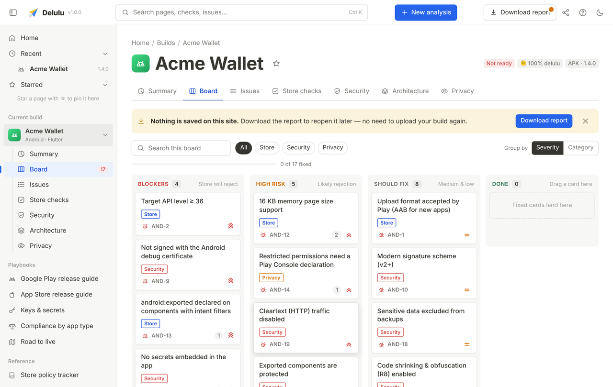
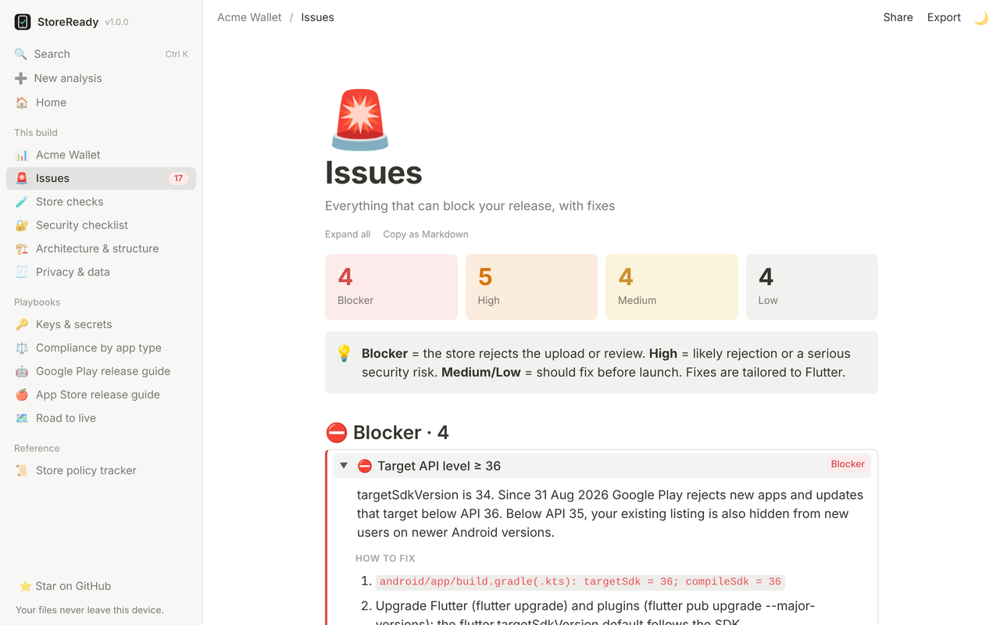
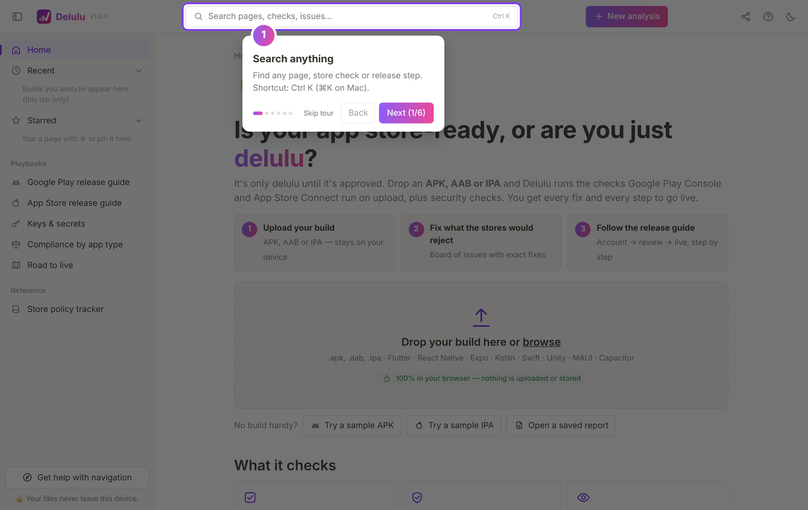
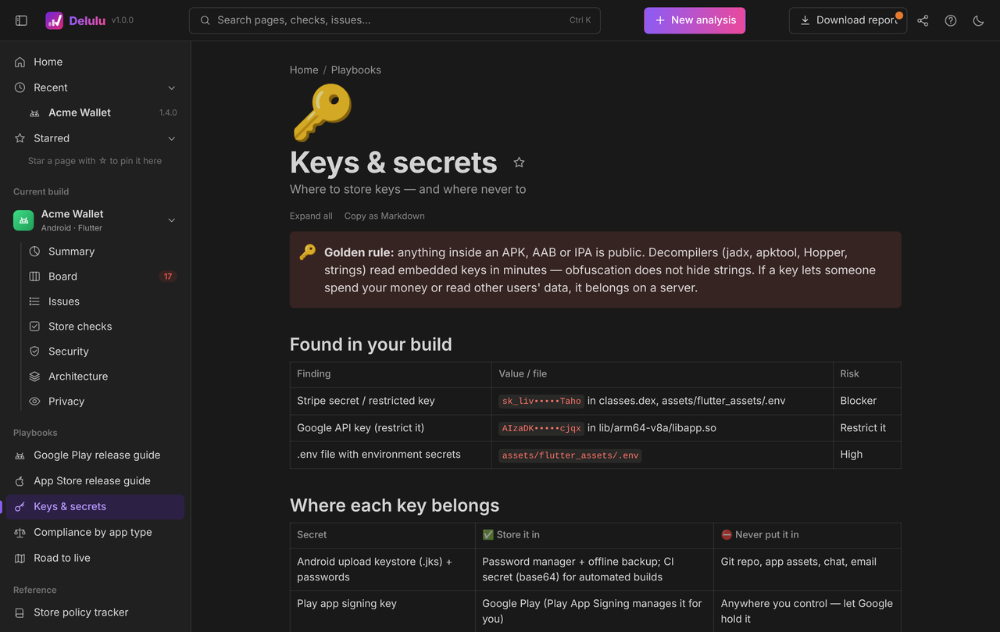

<div align="center">


### it's only delulu until it's approved ✈️

**Will your app pass Google Play & App Store review? Find out *before* you upload.**

Drop an **APK, AAB or IPA**. Delulu runs the checks **Play Console** and **App Store Connect** run on upload, plus OWASP security checks. You get every issue highlighted with a fix, plus Notion-style docs that walk you **step by step from build to live**.

**100% in your browser — your app is never uploaded anywhere.**

[**✈️ Open Delulu**](https://sanket-manohar.github.io/delulu/) · [Try the sample APK](https://sanket-manohar.github.io/delulu/) · [CLI & GitHub Action](#-cli--ci) · [What it checks](#-what-it-checks)

[](https://github.com/sanket-manohar/delulu/actions/workflows/ci.yml)
[](LICENSE)


[](CONTRIBUTING.md)
[](https://github.com/sponsors/sanket-manohar)



</div>

---

## 😩 Why this exists

You finish the app, upload the build and wait. Then come the emails:

> *ITMS-90683: Missing purpose string in Info.plist* · *Your app must target Android 16 (API level 36)* · *App must support 16 KB memory page sizes* · *ITMS-91053: Missing API declaration* · *Your app is signed with a debug certificate*…

Each rejection costs a day or more. Each leaked API key costs money. Delulu catches these problems **on your machine, in seconds**. It then hands you the exact fix for **your** framework and the full release checklist, so nothing is missed between "it builds" and "it's live".

## ✨ Features

| | |
|---|---|
| 🧪 **Store upload checks** | The automated checks Play Console & App Store Connect run on upload, with the matching **ITMS error codes** |
| 🚨 **Highlighted issues** | Blocker / High / Medium / Low, each with evidence and **framework-specific fix steps** |
| 🔐 **Security (OWASP MASVS v2)** | Hard-coded secrets (Stripe, AWS, OpenAI, Razorpay, private keys…), leaked keystores and `.env` files, cleartext traffic, ATS, exported components, WebView risks, obfuscation, backups |
| 🔑 **Keys & secrets playbook** | Where every key belongs (and must **never** be) for Flutter, React Native, Expo, Kotlin and Swift, plus CI signing without committing keystores |
| 🧾 **Privacy drafts** | Draft **Data safety** / **App Privacy** answers inferred from permissions and 35+ SDK fingerprints |
| ⚖️ **Compliance by app type** | Kids, health, finance/lending (RBI rules), games, social/UGC, dating, VPN, crypto, news, WebView wrappers… |
| 🏗️ **Architecture report** | Framework & engine, languages, SDK inventory, components, deep links, native libs, size breakdown |
| 🗺️ **Step-by-step to live** | Account → signing → build → testing tracks → review → staged rollout, for both stores, with copy-paste commands |
| 📝 **Exports** | Docs pack (.zip of Markdown), single Markdown, PDF, raw JSON, plus a README badge |
| 🗂️ **Issue board** | Every problem is a card (AND-2, IOS-7…). Drag it to **Done** when fixed; open it for evidence and the exact fix |
| 🫠 **Delulu meter** | How far your build is from store-ready. 0% delulu = ship it |
| 🧭 **Guided tour** | Numbered walkthrough on first visit; replay any time from Help or by pressing `?` |
| 💾 **Download & reopen** | Nothing is stored. Download a `.delulu.json` report and drop it back in later. No re-upload, progress included |
| 🎨 **Jira × Notion workspace** | Top search, nested sidebar (Recent, Starred, current build), tabs, toggles, dark mode, smooth animations |

<table><tr>
<td></td>
<td></td>
</tr><tr>
<td></td>
<td></td>
</tr></table>

## 🧪 What it checks

### Google Play (APK / AAB)

| Check | Why the store cares |
|---|---|
| Target API **≥ 36** (Wear 35, TV 34) | New apps & updates rejected since **31 Aug 2026** |
| **16 KB page size** (ELF LOAD alignment + zip alignment) | Required for apps targeting Android 15+ |
| 64-bit `arm64-v8a` libraries | 64-bit requirement |
| Not debuggable / not `testOnly` / not a framework debug build | Upload rejected |
| Signed, not with the **Android Debug** certificate, v2+ scheme | Upload rejected / insecure |
| `android:exported` on components with intent filters | Install failure on Android 12+ |
| `com.example.*` package, versionCode | Upload rejected |
| Restricted permissions (SMS, Call log, All files, Background location, Exact alarm, Photo/Video, Accessibility…) | Need Play Console declarations |
| Advertising ID, foreground-service types, Data safety | Policy declarations |
| AAB vs APK, download size, App Links `autoVerify` | Publishing & quality |
| Android **developer verification** (from Sep 2026) | Sideloaded and store apps alike |

### App Store (IPA)

| Check | Code |
|---|---|
| Built with **Xcode 26 / iOS 26 SDK** | ITMS-90725 |
| Deployment target **iOS 13+** | Sep 2026 rule |
| Purpose strings for every protected API found in the binary | ITMS-90683 |
| **Privacy manifest** covers required-reason APIs | ITMS-91053 |
| Third-party SDKs ship privacy manifests | ITMS-91061 |
| No `UIWebView` | ITMS-90809 |
| No simulator slices in frameworks | ITMS-90087 |
| App Store distribution profile, `get-task-allow=false`, profile expiry, bundle-ID match, production APNs | ITMS-90161 / 90164 / 90046 |
| Launch screen, icon asset catalog, iPad multitasking orientations, version formats, extension IDs | ITMS-90477 / 90713 / 90474 / 90060 / 90345 |
| ATT before tracking, Sign in with Apple when social login exists, ATS, export compliance, background modes | Guidelines 5.1.2 / 4.8 / 2.5.4 |

### Both platforms: security & privacy

Secrets in DEX, JS bundles, Dart AOT snapshots, Mach-O binaries and config files · packaged keystores/`.p8`/`.p12`/`.env`/service-account JSON/source maps · insecure `http://` endpoints · certificate pinning · Play Integrity / App Attest / App Check · Keystore/Keychain usage · R8 obfuscation · PIE.

**Frameworks detected:** Flutter · React Native (Hermes/JSC) · Expo · Native Kotlin/Java (+ Jetpack Compose) · Native Swift/Obj-C (+ SwiftUI) · Kotlin Multiplatform · Unity · Unreal · .NET MAUI/Xamarin · Capacitor · Cordova.

> ⚠️ Delulu is not affiliated with Google or Apple, and it can't predict human review. The **Store policy tracker** page lists every rule with its official source and the date it was last reviewed.

## 🚀 Use it

**Web:** open the [hosted site](https://sanket-manohar.github.io/delulu/) and drop your build, or click **Try a sample** to see a full report in seconds.

**Run locally** (no install, no build step):

```bash
git clone https://github.com/sanket-manohar/delulu.git
cd delulu
python3 -m http.server 8080   # or: npx serve .
# open http://localhost:8080
```

## 🤖 CLI & CI

Node 20+, zero dependencies:

```bash
node cli/delulu.mjs app-release.aab                 # pretty report, exit 1 on blockers
node cli/delulu.mjs App.ipa --out delulu-docs   # + Markdown docs pack & report.json
node cli/delulu.mjs app.apk --json --fail-on high   # JSON, fail on high or worse
```

**GitHub Action:** gate every release build.

```yaml
- uses: sanket-manohar/delulu@v1
  with:
    file: build/app/outputs/bundle/release/app-release.aab
    fail-on: blocker        # blocker | high | medium | low | none
    app-type: finance       # adds category-specific compliance items to the docs
```

The issues list is added to the job summary, and the full docs pack is written to `delulu-report/`.

**Show your score:** after analyzing, choose *Share → Copy README badge*:


## 🔒 Privacy & security of Delulu itself

- Files are read with the browser's `Blob` + `DecompressionStream` APIs. Nothing is uploaded, and there is no backend, analytics, cookies or third-party script.
- A strict **Content-Security-Policy** (`default-src 'self'`) blocks all network requests from the page.
- Detected secrets are **masked** in every report and export.
- Streaming ZIP reader: multi-GB IPAs are analyzed without loading them into memory.

## 🏗️ How it works

```
index.html ─ src/ui/app.js (Notion-style workspace, router, exports)
              │
              ├─ src/analyzers/   android.js · ios.js · common.js (ReportBuilder)
              ├─ src/core/        zip · axml · protoxml (AAB) · plist (xml+binary) · binary (ELF/Mach-O) · scanner
              ├─ src/rules/       policy.js (dated store rules) · signatures.js (SDKs, permissions, APIs)
              └─ src/report/      pages.js (block model) · markdown.js · frameworks.js (commands)
cli/delulu.mjs ─ same analyzers in Node
```

Read [docs/ARCHITECTURE.md](docs/ARCHITECTURE.md), [docs/ADDING_RULES.md](docs/ADDING_RULES.md) and [docs/RELEASE.md](docs/RELEASE.md).

## ☕ Donations

The site has a **Buy the dev a coffee** popup (preset ₹/$ amounts or any custom amount) and a shimmering **Star on GitHub** button. Set your payment link in `src/config.js`:

```js
export const DONATE = {
  url: 'https://github.com/sponsors/sanket-manohar', // or a Razorpay page / UPI link with {amount}
  defaultCurrency: 'INR',
  presets: { INR: [49, 99, 199, 499], USD: [2, 5, 10, 25] },
};
```

The official build points to [GitHub Sponsors](https://github.com/sponsors/sanket-manohar). If `url` is empty, the button thanks the user and says donations open soon. The popup opens automatically at most once a week, after a report is downloaded or a minute into a report.

## 🤝 Contributing

Store rules change every year: Google updates its target API rule each August, and Apple raises the minimum SDK each spring. **Keeping `src/rules/policy.js` current is the most valuable contribution.** New checks, SDK fingerprints and framework guides are welcome too. See [CONTRIBUTING.md](CONTRIBUTING.md).

```bash
npm test   # 18 tests, node:test, no dependencies
```

## 👋 Creator

Built by **Sanket Manohar**: [sanketmanohar.com](https://sanketmanohar.com) · [YouTube](https://www.youtube.com/@sanketmanoharstudio) · [GitHub](https://github.com/sanket-manohar)

If Delulu helped you, you can [sponsor the project on GitHub](https://github.com/sponsors/sanket-manohar) 💛

## 📄 License

[MIT](LICENSE). Google Play and Android are trademarks of Google LLC; App Store, iOS and Xcode are trademarks of Apple Inc. They are used here only to describe compatibility.

<div align="center">

**If Delulu saved you from a rejection, drop a ⭐ so other devs find it. it's only delulu until it's approved ✈️**

</div>
